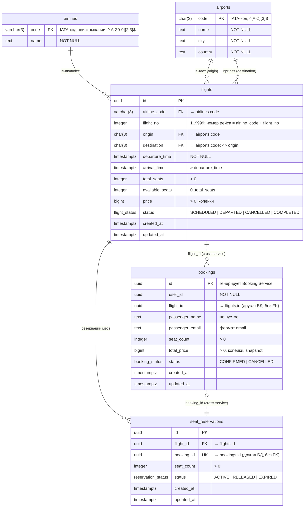

# ER-диаграмма

Две независимые БД: `flights` (Flight Service) и `bookings` (Booking Service). Связи между базами (`booking_id`, `flight_id`) логические: внешнего ключа между разными БД нет, целостность обеспечивается вызовами через gRPC.

Сплошные линии — внешние ключи внутри одной БД, пунктир — логические связи между сервисами.

## Ограничения целостности

| Таблица | Ограничение | Смысл |
|---|---|---|
| `airports` | `PK (code)`, `CHECK (code ~ '^[A-Z]{3}$')` | IATA-код аэропорта |
| `airlines` | `PK (code)`, `CHECK (code ~ '^[A-Z0-9]{2,3}$')` | код авиакомпании |
| `flights` | `FK airline_code`, `FK origin`, `FK destination` | ссылочная целостность |
| | `CHECK (flight_no BETWEEN 1 AND 9999)` | номер рейса |
| | `CHECK (total_seats > 0)` | общее число мест строго положительно |
| | `CHECK (available_seats >= 0 AND available_seats <= total_seats)` | свободных мест не меньше нуля и не больше общего числа |
| | `CHECK (price > 0)` | цена строго положительна |
| | `CHECK (arrival_time > departure_time)` | прилёт позже вылета |
| | `CHECK (origin <> destination)` | разные аэропорты |
| | `UNIQUE (airline_code, flight_no, (departure_time AT TIME ZONE 'UTC')::date)` | номер рейса + дата вылета уникальны |
| `seat_reservations` | `FK flight_id`, `UNIQUE (booking_id)` | одному бронированию — ровно одна резервация |
| | `CHECK (seat_count > 0)` | |
| `bookings` | `CHECK (seat_count > 0)`, `CHECK (total_price > 0)` | |
| | `CHECK (length(btrim(passenger_name)) > 0)`, `CHECK (passenger_email ~ '^[^@\s]+@[^@\s]+$')` | данные пассажира |
| все | `NOT NULL` на всех полях, статусы — PostgreSQL `ENUM` | |

Индексы: `flights (origin, destination, departure_time)` — для `SearchFlights`; `seat_reservations (flight_id)`; `bookings (user_id, created_at DESC)` — для списка бронирований пользователя.

## Почему это 3NF

- **1NF:** все атрибуты атомарны, повторяющихся групп нет.
- **2NF:** во всех таблицах первичный ключ состоит из одного атрибута, поэтому частичных зависимостей быть не может.
- **3NF:** транзитивных зависимостей неключевых атрибутов от ключа нет:
  - название авиакомпании зависит от её кода, а не от рейса, поэтому оно вынесено в `airlines`; аэропорты — в `airports`;
  - номер рейса хранится как `airline_code` + `flight_no`, а не строкой `"SU1234"`: такая строка сама определяла бы авиакомпанию (`id → flight_number → airline_code`);
  - данные пассажира (`passenger_name`, `passenger_email`) относятся к конкретному бронированию и зависят только от `bookings.id`.
